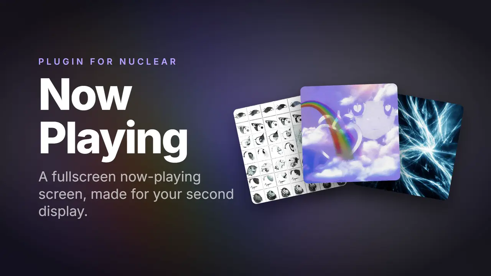
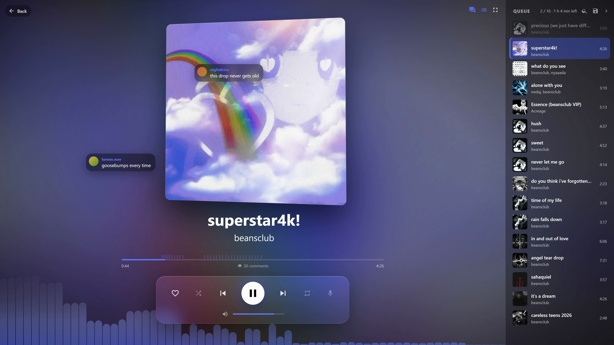
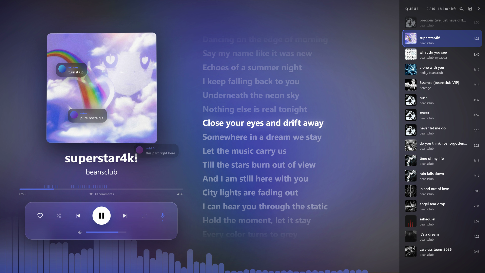

<div align="center">

# Now Playing

**A fullscreen now-playing screen for the [Nuclear](https://github.com/nukeop/nuclear) music player.**

Big artwork, synced lyrics, SoundCloud timed comments and a live visualizer, designed to run on a second display.

[](LICENSE)




[Watch the full demo with sound (MP4)](docs/demo.mp4)

</div>

## Features

- **Now Playing screen.** Full-bleed artwork with a blurred, color-matched background, plus title, artist, album, seek bar, volume and playback controls.
- **Synced lyrics.** Line- and word-level highlighting from any lyrics provider installed in Nuclear. Click a line to seek.
- **SoundCloud timed comments.** Comments appear at the exact second they were posted, with markers on the timeline. This works for songs streamed from any source.
- **Audio visualizer.** Frequency bars or waveform, driven by the actual audio output, with automatic gain so loud masters stay readable.
- **Motion effects.** The artwork tilts in 3D towards the cursor with a glass shine, breathes with the bass and flips in on track changes. A beat-reactive glow and light pulse follow the music.
- **Queue panel.** Search, drag to reorder, remove, resize, collapse and save the queue as a playlist.
- **Up next.** A card previews the next song during the last 10 seconds.
- **Favorites.** Like the current song without leaving the screen.
- **Double-click to play.** Double-click any track row in Nuclear (playlists, albums, search, favorites) to play it.
- **Auto-skip.** Songs that fail to load are skipped automatically.
- **Spotify import.** Turn Spotify playlists, albums or a list of track links into a Nuclear playlist, with no account or API key.
- **English and Spanish.** The plugin follows Nuclear's language setting.

<p align="center">
  
  
</p>

## Installation

1. Download `plugin.zip` from the [latest release](../../releases/latest) and extract it to a folder.
2. In Nuclear, open **Preferences → Plugins → Add Plugin** and select that folder.
3. Enable **Now Playing**.

To run from source, clone this repository and add the cloned folder instead. Nuclear compiles the TypeScript on load.

## Usage

Open the screen with the button next to the volume control, press <kbd>F9</kbd>, or use **Settings → Now Playing**. Press <kbd>Esc</kbd> to return to Nuclear.

| Key | Action |
|---|---|
| <kbd>F9</kbd> | Open / close the screen |
| <kbd>Space</kbd> | Play / pause |
| <kbd>←</kbd> <kbd>→</kbd> | Previous / next track |
| <kbd>↑</kbd> <kbd>↓</kbd> | Volume |
| <kbd>M</kbd> | Mute |
| <kbd>S</kbd> / <kbd>R</kbd> | Shuffle / repeat |
| <kbd>H</kbd> | Favorite |
| <kbd>L</kbd> | Lyrics |
| <kbd>C</kbd> | SoundCloud comments |
| <kbd>Q</kbd> | Show / hide the queue |
| <kbd>/</kbd> | Search the queue |
| <kbd>F</kbd> | Fullscreen |
| <kbd>Esc</kbd> | Back to Nuclear |

## Settings

Available under **Settings → Now Playing**:

| Setting | Default |
|---|---|
| Background blur | 80 px |
| Motion effects | On (off when the OS reduces motion) |
| Animated background | On |
| Visualizer (off, bars or wave) | Bars |
| Show clock | Off |
| Always show “Back” | Off |
| “Up next” card | On |
| Skip songs that fail to load | On |
| SoundCloud comments | On |
| Open with lyrics | Off |

The Spotify importer is in the same section. You can also paste a Spotify link into Nuclear's **Import playlist** screen.

## Notes and limitations

- **No official UI hooks.** Nuclear's plugin API has no way to add UI elements, so the player-bar button and double-click-to-play attach to Nuclear's interface directly. A future Nuclear update could break them. <kbd>F9</kbd> and the settings entry keep working either way.
- **Visualizer signal.** The visualizer reads the playing `<audio>` element through `captureStream()`. When a stream cannot be captured, the bars fade out and a diagnostic message is written to the developer console.
- **Spotify import scope.** Spotify's public embed exposes at most 100 tracks per playlist. Imported tracks carry metadata only (title, artists, duration and artwork); Nuclear resolves the audio through your configured streaming provider.
- **Lyrics provider required.** Lyrics need at least one lyrics plugin installed in Nuclear.

## Development

The plugin is plain TypeScript with no build step. Nuclear bundles it with esbuild when it loads.

```
index.ts        plugin lifecycle (onLoad / onEnable / onDisable)
screen.ts       Now Playing screen and queue panel
lyrics.ts       synced lyrics panel
comments.ts     SoundCloud timed comments
visualizer.ts   audio visualizer and beat detection
effects.ts      3D tilt, glow, pulse and flip effects
importer.ts     Spotify importer (playlist provider + settings widget)
autoskip.ts     skip songs that fail to load
doubleclick.ts  double-click to play
settings.ts     settings definitions
i18n.ts         English and Spanish strings
styles.ts       screen styles
```

Check that it compiles the same way Nuclear does:

```sh
npx esbuild index.ts --bundle --format=cjs --platform=browser --external:react --outfile=/tmp/check.js
```

### Releasing

Bump `version` in `package.json`, then push a matching tag:

```sh
git tag v1.0.1 && git push origin v1.0.1
```

The release workflow verifies the build and publishes a GitHub release with `plugin.zip`.

## License

[MIT](LICENSE)
